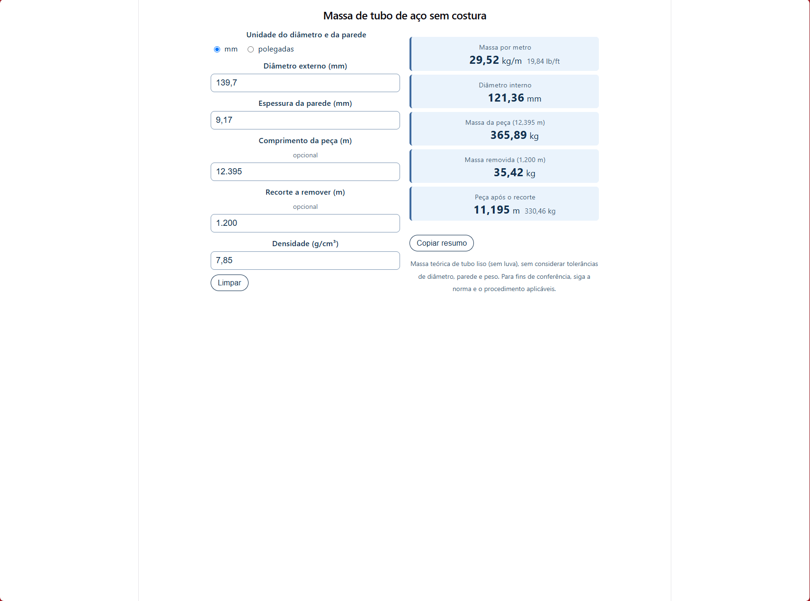

# Calculadora de massa de tubo

Calcula a massa teórica de tubos de aço sem costura a partir do diâmetro externo, da espessura de parede e do comprimento, com as tolerâncias e o efeito de um recorte.



**Demo:** _(https://calculadora-massa-aco.vercel.app/)_

## Por que criei

Trabalho como inspetor de qualidade em uma empresa que atua nos setores de: petróleo e gás, energia, indústria, automotivo e construção, produzindo tubos de aço sem costura. No dia a dia é comum precisar estimar a massa de um tubo e saber quanto ela muda quando uma parte é cortada para ajustar o tamanho ou remover um defeito. Criei esta calculadora para fazer isso de forma rápida e conferível. Também faz parte dos meus estudos de desenvolvimento web com React.

## O que ele faz

- Massa por metro e massa total do tubo, em kg e em lb/ft.
- Faixas mínima e máxima a partir das tolerâncias de diâmetro, parede e comprimento.
- Massa do trecho removido e massa restante após um recorte.

## Como calcula

```
massa por metro (kg/m) = π · t · (OD − t) · ρ / 1000
```

- `OD`: diâmetro externo (mm)
- `t`: espessura de parede (mm)
- `ρ`: densidade do aço, 7,85 g/cm³
- Conversão: 1 kg/m = 0,671969 lb/ft

## Tecnologias

React, Vite, JavaScript, CSS

## Como rodar

Requisito: [Node.js](https://nodejs.org) 18 ou superior.

```bash
git clone https://github.com/Negoedd-Dev/calculadora-massa
cd calculadora-massa
npm install
npm run dev
```

Abra o endereço que aparecer no terminal (normalmente http://localhost:5173).
Sem o Git, baixe o ZIP pelo botão verde **Code** desta página.

## Observações

- É uma massa **teórica**, calculada pela geometria nominal e pela densidade informada. Não substitui a pesagem real.
- Os valores de exemplo são fictícios e não representam nenhuma norma ou cliente específico.

## Autor

Negoedd · [LinkedIn](https://www.linkedin.com/in/edson-nunes)
